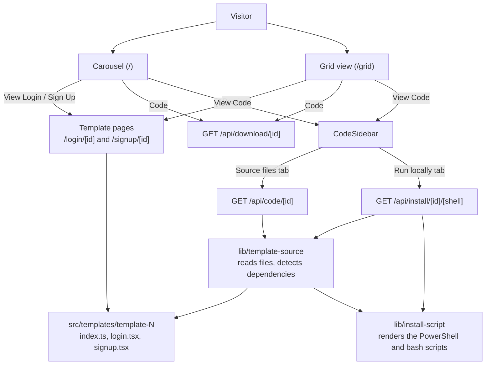

<div align="center">

# AuthShowcase

**A curated gallery of 10 distinct, fully responsive login and sign-up templates for Next.js. Preview them live, read the source in the browser, then run one command to get the code.**

[](https://auth-ui-showcase-rho.vercel.app)
[](./LICENSE)
[](https://github.com/shaurya-10000/auth-ui-showcase/commits/main)

[](https://nextjs.org)
[](https://react.dev)
[](https://www.typescriptlang.org)
[](https://tailwindcss.com)

<!-- TODO: take a fresh screenshot of the carousel (Win+Shift+S), save it as docs/assets/hero.png, then delete these two comment lines and the comment markers around the image below.

-->

[**Live demo**](https://auth-ui-showcase-rho.vercel.app) · [**Features**](#features) · [**Templates**](#templates) · [**Quick start**](#quick-start) · [**Use a template**](#using-a-template)

</div>

---

## Overview

|  |  |
| :--- | :--- |
| **What** | A gallery of 10 authentication UI designs. Each template ships a login page and a sign-up page, previewed live in a carousel or a grid. |
| **Why it's interesting** | Previews are the real components, rendered at 1440x810 and scaled to fit, not screenshots. The same template folder powers the in-browser code viewer and the no-zip installer scripts, so there is one source of truth. |
| **Stack** | Next.js (App Router) · React · TypeScript · Tailwind CSS · lucide-react |

## Contents

- [Features](#features)
- [Templates](#templates)
- [Architecture](#architecture)
- [Design decisions](#design-decisions)
- [Quick start](#quick-start)
- [Using a template](#using-a-template)
- [Scripts](#scripts)
- [Project structure](#project-structure)
- [Adding a new template](#adding-a-new-template)
- [API routes](#api-routes)
- [Deployment](#deployment)
- [Security notes](#security-notes)
- [Troubleshooting](#troubleshooting)
- [Known limitations](#known-limitations)
- [Roadmap](#roadmap)
- [Contributing](#contributing)
- [License](#license)

---

## Features

- **Live carousel.** Every slide is a working login component scaled into a preview box. Navigate with the arrow buttons, or swipe on touch devices.
- **Grid view.** See all 10 templates at once at `/grid`. Each card has Preview, Code and View Code buttons.
- **Login and sign-up pages.** Every template has both, reachable at `/login/<id>` and `/signup/<id>`, with a back button that returns to the gallery and a day/night toggle.
- **View Code sidebar.** A drawer with two tabs. **Source files** lists every file of the template with line numbers and a copy button per file. **Run locally** gives you the install commands. Available from both the carousel and the grid.
- **Run without a zip.** One PowerShell or Terminal command creates a fresh Next.js app, drops the template in, installs its dependencies and starts the dev server.
- **Zip download.** The **Code** button downloads the template as an archive.
- **Responsive and accessible.** The sidebar is a labelled dialog that closes with Esc and restores focus; icon buttons have accessible names.

| Area | What it does |
| :--- | :--- |
| **Carousel** | Live scaled previews, arrows, touch swipe, progress dots |
| **Grid view** | All templates in a responsive 1 / 2 / 3 column grid |
| **Template pages** | Login and sign-up for each design, with a back button |
| **Code viewer** | Files, line numbers, copy per file, loaded on demand |
| **Installers** | Generated PowerShell and bash scripts per template |
| **Download** | Zip of a template's code |

---

## Templates

| ID | Name | Description | Tags |
| :--- | :--- | :--- | :--- |
| `template-1` | **Minimal SaaS** | A clean, distraction-free authentication flow designed for modern B2B applications. | Clean, Light Mode, B2B |
| `template-2` | **Glassmorphism** | Frosted glass effects with vibrant background blurs and subtle borders. | Trendy, Dark Mode, Visual |
| `template-3` | **Neo-Brutalist** | High contrast, thick borders, and aggressive layouts for a bold impression. | Bold, High Contrast, Experimental |
| `template-4` | **Cyberpunk Terminal** | A raw, neon-accented terminal interface for the modern hacker. | Cyberpunk, Terminal, Dark Mode |
| `template-5` | **Neumorphism** | Soft, extruded UI elements with subtle shadows and a clean, tactile feel. | Soft UI, Light Mode, Tactile |
| `template-6` | **Bento Grid** | A modern, card-based layout with large rounded corners and a clean aesthetic. | Modern, Card UI, Minimal |
| `template-7` | **Brutalist Pastel** | Playful pastel colors mixed with heavy, chunky black borders. | Retro, Playful, Bold |
| `template-8` | **Skeuomorphism** | Realistic, tactile UI elements with gradients and deep shadows. | 3D, Classic, Realistic |

<!-- TODO: add screenshots to docs/assets/ and uncomment this gallery.

| Carousel | Grid view |
| :---: | :---: |
|  |  |
| **View Code sidebar** | **Run locally tab** |
|  |  |
-->

---

## Architecture

The gallery pages, the template pages and the code tooling all read from the same template folders.



<details>
<summary>Plain-text version of the diagram</summary>

```text
Carousel (/) ----+                      +--> GET /api/download/[id]   (zip)
                 |--> Template pages    |
Grid (/grid) ----+    /login/[id]       |
                      /signup/[id]      |
                                        |
View Code sidebar --> /api/code/[id] ---+--> lib/template-source --> src/templates/template-N
                  --> /api/install/[id]/[shell] --> lib/install-script
```

</details>

### Design principles

1. **One source of truth.** The code viewer and the installer scripts read from `src/templates/<id>`. Update a template and both update with it.
2. **Previews are real components.** A 1440x810 canvas is scaled with a CSS transform and a `ResizeObserver`, so a preview always matches the actual page.
3. **Allowlist, not user paths.** Template ids are validated against `src/config/templates.ts` before any file is read.
4. **Load on demand.** Source files are fetched the first time a template's sidebar opens, then kept in memory.

## Design decisions

| Decision | Why | Trade-off |
| :--- | :--- | :--- |
| **Live scaled components instead of screenshots** | Previews are always accurate and never go stale | Every preview renders a full page, which is heavier on the grid |
| **Installer scripts embed the files** | One request, nothing to host, and the script can be read before running | Scripts grow with the template size |
| **Generate scripts per template on the server** | Dependencies and remote image hosts are detected from the real imports | Only files inside the template folder are included |
| **Touch swipe on the page wrapper, not the preview** | Gesture works anywhere on the slide without fighting button taps | Mouse drag is not supported; desktop uses the arrows |
| **Swipe needs 50px and a mostly horizontal move** | Vertical scrolling and taps never trigger a slide change | Very short flicks are ignored |
| **Shared `CodeSidebar` component** | Carousel and grid get identical behavior from one implementation | The grid keeps one shared drawer rather than one per card |

---

## Quick start

Requires **Node.js 20 or newer**.

```bash
git clone https://github.com/shaurya-10000/auth-ui-showcase.git
cd auth-ui-showcase
npm install
npm run dev
```

Open [http://localhost:3000](http://localhost:3000). No environment variables are required.

## Using a template

### Option 1: Run it without downloading the zip

Open a terminal in the folder where you want the new project, then run the command for your system. You can also open **View Code > Run locally** on any template to copy the exact command.

**Windows (PowerShell)**

```powershell
irm "https://auth-ui-showcase-rho.vercel.app/api/install/template-1/ps1" | iex
```

**macOS / Linux (Terminal)**

```bash
bash <(curl -fsSL "https://auth-ui-showcase-rho.vercel.app/api/install/template-1/sh")
```

Change `template-1` to any template id from the [table above](#templates). The script:

1. Creates a new Next.js app (TypeScript, Tailwind, App Router) named `authshowcase-<id>`.
2. Adds the template and its login and sign-up routes.
3. Installs any extra packages the template imports.
4. Starts the dev server at `http://localhost:3000/login/<id>`.

> [!TIP]
> Piping a script into your shell runs it. Open the script URL in a browser first to read exactly what it does.

### Option 2: Download the zip

Click **Code** on any template in the carousel or the grid.

### Option 3: Copy the files manually

Click **View Code**, choose a file and use the copy button.

## Scripts

| Command | Description |
| :--- | :--- |
| `npm run dev` | Start the development server |
| `npm run build` | Create a production build |
| `npm run start` | Run the production build |
| `npm run lint` | Lint the project |

## Project structure

```text
src/
  app/
    page.tsx                      Carousel home page (swipe, arrows, View Code)
    grid/page.tsx                 Grid view of all templates
    layout.tsx                    Root layout (includes the back button)
    login/[id]/                   Login route per template
    signup/[id]/                  Sign-up route per template
    api/
      download/[id]/              Zip download
      code/[id]/                  Template source as JSON (View Code sidebar)
      install/[id]/[shell]/       Installer scripts (ps1 and sh)
  components/
    Header.tsx                    Site header with Carousel and Grid View links
    BackButton/                   Back button on login and sign-up pages
    CodeSidebar/                  View Code drawer: file list, viewer, run commands
  config/
    templates.ts                  Template metadata (id, name, description, tags)
  hooks/
    useSwipe.ts                   Touch swipe handling
  lib/
    template-source/              Reads template files, detects dependencies and image hosts
    install-script/               Builds the PowerShell and bash installers
  templates/
    template-1 ... template-10/    index.ts, login.tsx, signup.tsx per template
public/                           Static assets and icons
.github/workflows/                CI workflow
```

## Adding a new template

1. Create `src/templates/template-9/` with `login.tsx`, `signup.tsx` and an `index.ts`:

   ```ts
   export { default as Login } from "./login";
   export { default as Signup } from "./signup";
   ```

2. Add an entry to `src/config/templates.ts` with `id`, `name`, `description`, `tags` and `previewColor`.
3. Import its `Login` and add it to the preview maps in `src/app/page.tsx` and `src/app/grid/page.tsx`.
4. If the login and sign-up routes map template ids explicitly, register the new id there too.

The View Code sidebar, `/api/code` and the installer scripts read straight from the template folder, so they pick the new template up automatically.

## API routes

| Route | Description |
| :--- | :--- |
| `GET /api/download/[id]` | Download the template as a zip |
| `GET /api/code/[id]` | JSON: the template's files and contents |
| `GET /api/install/[id]/ps1` | PowerShell installer for the template |
| `GET /api/install/[id]/sh` | bash and zsh installer for the template |

Only ids listed in `src/config/templates.ts` are accepted. Anything else returns `404`.

## Deployment

[](https://vercel.com/new/clone?repository-url=https%3A%2F%2Fgithub.com%2Fshaurya-10000%2Fauth-ui-showcase)

1. Push to GitHub, or use the button above.
2. Import the repo at [vercel.com/new](https://vercel.com/new). Root directory: repository root.
3. Deploy. No environment variables are needed.

**Production URL:** [auth-ui-showcase-rho.vercel.app](https://auth-ui-showcase-rho.vercel.app)

The `/api/code` and `/api/install` routes declare `generateStaticParams`, so they are pre-rendered at build time from the template folders. The copied install commands use whatever domain the site is served from.

## Security notes

- **Template ids are allowlisted.** Every route checks the id against `src/config/templates.ts` before touching the filesystem, so a crafted id cannot read other files.
- **Read-only.** The API routes only read template files and return text or JSON. Nothing is written on the server.
- **Installers are transparent.** Scripts embed plain file contents with no variable expansion (here-strings in PowerShell, quoted heredocs in bash), and can be opened in a browser before you run them.
- **No secrets.** The project has no environment variables, keys or user data.

## Troubleshooting

| Symptom | Cause | Fix |
| :--- | :--- | :--- |
| View Code shows "Could not load the source" | `/api/code/[id]` returned an error | Check that the template folder exists and the id is listed in `src/config/templates.ts` |
| Installer says "Folder already exists" | A previous run created `authshowcase-<id>` | Delete that folder or run the command from another directory |
| Installer says Node.js 20 is required | Older Node version | Install Node 20 or newer from [nodejs.org](https://nodejs.org) |
| Avatars or remote images do not load | The host is missing from `next.config.ts` `images.remotePatterns` | Add the host. The installer does this automatically for new projects |
| Swipe does nothing on desktop | Swipe uses touch events | Use the arrows, or Chrome DevTools device mode (`Ctrl+Shift+M`) |
| Page behind the sidebar scrolls on the grid | Sidebar is closed or scroll lock was removed | Reopen View Code; the sidebar locks page scroll while open |

## Known limitations

- **Installers include only the template folder.** If a template depends on shared components or global CSS, copy those separately.
- **Plain-text code viewer.** The sidebar shows line numbers and copy, but no syntax highlighting yet.
- **Grid renders every preview.** All 10 live previews mount at once, which is fine at this size but heavier than static images.
- **Touch only for swipe.** Mouse drag and keyboard arrows are not wired to the carousel.
- **Remote avatars.** Some previews load sample avatars from a third-party host and need a network connection.

## Roadmap

- [ ] Syntax highlighting in the code viewer
- [ ] Keyboard arrow navigation for the carousel
- [ ] "Copy all files" in the sidebar
- [ ] More templates
- [ ] Automated tests and a CI check for typecheck, lint and build on every PR
- [ ] A one-command CLI (for example via `npx`) as an alternative to the scripts

## Contributing

Contributions are welcome.

1. Fork the repo and create a branch: `git checkout -b feat/your-change`.
2. Make your change. New templates should include both `login.tsx` and `signup.tsx`.
3. Run the pre-flight check: `npm run lint && npm run build`.
4. Open a pull request describing what changed and why.

## License

Released under the MIT license. See [LICENSE](./LICENSE).

---

<div align="center">

**AuthShowcase** · built by [@shaurya-10000](https://github.com/shaurya-10000)

</div>