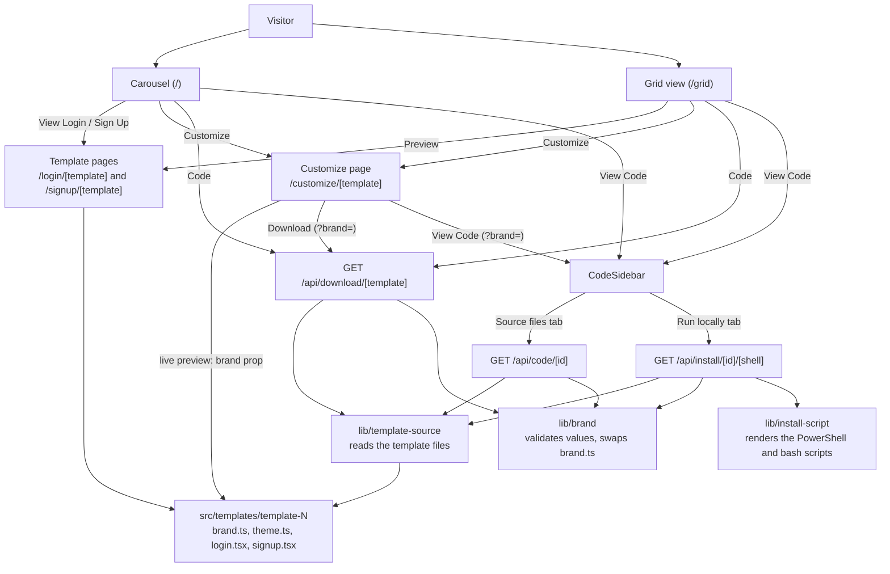

<div align="center">

# AuthShowcase

**A curated gallery of 16 distinct, fully responsive login and sign-up templates for Next.js. Preview them live, customize the branding, read the source in the browser, then download it or run one command to get the code.**

[](https://auth-ui-showcase-rho.vercel.app)
[](./LICENSE)
[](https://github.com/shaurya-10000/auth-ui-showcase/commits/main)

[](https://nextjs.org)
[](https://react.dev)
[](https://www.typescriptlang.org)
[](https://tailwindcss.com)

<!-- TODO: take a fresh screenshot of the carousel (Win+Shift+S), save it as docs/assets/hero.png, then delete these two comment lines and the comment markers around the image below.

-->

[**Live demo**](https://auth-ui-showcase-rho.vercel.app) · [**Features**](#features) · [**Customize**](#customizing-a-template) · [**Templates**](#templates) · [**Quick start**](#quick-start) · [**Use a template**](#using-a-template)

</div>

---

## Overview

|  |  |
| :--- | :--- |
| **What** | A gallery of 16 authentication UI designs. Each template ships a login page and a sign-up page, previewed live in a carousel or a grid. |
| **New: branding** | Open **Customize** on a template to change its text, logo and colors with a live preview. The zip, the code viewer and the install commands all include your changes. |
| **Why it's interesting** | Previews are the real components, rendered at 1440x810 and scaled to fit, not screenshots. One template folder powers the preview, the zip, the in-browser code viewer and the installer scripts, so there is a single source of truth. |
| **Stack** | Next.js 16 (App Router) · React 19 · TypeScript · Tailwind CSS 4 · lucide-react · JSZip |

## Contents

- [Features](#features)
- [Customizing a template](#customizing-a-template)
- [Templates](#templates)
- [Architecture](#architecture)
- [Design decisions](#design-decisions)
- [Quick start](#quick-start)
- [Using a template](#using-a-template)
- [Scripts](#scripts)
- [Project structure](#project-structure)
- [Adding a new template](#adding-a-new-template)
- [Making a template customizable](#making-a-template-customizable)
- [Routes and API](#routes-and-api)
- [Deployment](#deployment)
- [Security notes](#security-notes)
- [Troubleshooting](#troubleshooting)
- [Known limitations](#known-limitations)
- [Roadmap](#roadmap)
- [Contributing](#contributing)
- [License](#license)

---

## Features

- **Live carousel.** Every slide is a working login component scaled into a preview box. Navigate with the arrow buttons, or swipe on touch devices.
- **Grid view.** See all 16 templates at once at `/grid`. Each card has Preview, Code, View Code and Customize buttons.
- **Customize.** Edit the brand name, logo, colors, titles, button labels, side-panel copy, optional sections and legal links at `/customize/<template>`. The preview updates as you type, and the result is shareable as a link.
- **Customized exports.** Download, View Code and the install commands all use your customized values, so what you see in the code viewer is exactly what you download or install.
- **Login and sign-up pages.** Every template has both, reachable at `/login/<id>` and `/signup/<id>`, with a back button that returns to the gallery and a day/night toggle.
- **View Code sidebar.** A drawer with **Source files** (every file of the template with line numbers and a copy button) and **Run locally** (the install commands). Available from the carousel, the grid and the customize page.
- **Run without a zip.** One PowerShell or Terminal command creates a fresh Next.js app, drops the template in, installs its dependencies and starts the dev server.
- **Zip download.** The **Code** button downloads the full template folder as an archive.
- **Responsive and accessible.** The sidebar is a labelled dialog that closes with Esc and restores focus; icon buttons have accessible names.

| Area | What it does |
| :--- | :--- |
| **Carousel** | Live scaled previews, arrows, touch swipe, progress dots |
| **Grid view** | All templates in a responsive 1 / 2 / 3 column grid |
| **Customize page** | Form plus live preview, login and sign-up switch, reset, copy link, download, view code |
| **Template pages** | Login and sign-up for each design, with a back button |
| **Code viewer** | Files, line numbers, copy per file, loaded on demand |
| **Installers** | Generated PowerShell and bash scripts per template |
| **Download** | Zip of the template's files, customized if you changed anything |

---

## Customizing a template

Open **Customize** on a carousel slide or a grid card, or go straight to `/customize/template-1`.

1. **Edit** the fields on the left. The preview updates live, and you can switch between the login and sign-up pages.
2. **Share** your design with **Copy link**. The changes are encoded in the URL, so the link opens the same design.
3. **Get the code** with **Download** (zip) or **View Code** (browse the files and copy the install commands).

### What you can change

| Group | Fields |
| :--- | :--- |
| **Identity** | Brand name, logo image URL |
| **Colors** | Accent color (some templates also have a sign-up page color or a light theme color) |
| **Login page** | Title, subtitle, button label, sign-up prompt and link text, reset link text, terminal title |
| **Sign-up page** | Title, subtitle, button label, sign-in prompt and link text, terminal title |
| **Side panel** | Headline and text for login and sign-up, trust line |
| **Options** | Google and GitHub buttons on or off, Remember me on or off |
| **Links** | Terms URL, Privacy URL |
| **Typography** | Font family (Google Fonts), heading weight, body, heading and headline sizes (template-1 so far) |
| **Styling** | Light and dark theme colors, button text color, corner radius, side panel gradient and text colors (template-1 so far) |

Each template exposes only the fields that make sense for its design, so the form differs per template. Leave the brand name and logo empty to hide the brand mark.

### Where customization is available

Customization is live for the templates marked in the [table below](#templates). Templates without it show a disabled **Customize (soon)** button.

### How it works

Every customizable template has a small `brand.ts` file holding its defaults, and its pages read their text and accent colors from it:

```ts
// src/templates/template-1/brand.ts
export const brand = {
  name: "",
  logoUrl: "",
  accent: "#4f46e5",
  loginTitle: "Welcome back",
  loginSubmit: "Sign in",
  headline: "Build faster with\nminimal design.",
  showSocial: true,
  // ...
};

export type Brand = typeof brand;
```

- **Live preview.** The Customize page passes your edited values to the template as a `brand` prop.
- **Exports.** The zip, the code viewer and the installer scripts read the template's real files and replace only `brand.ts` with one built from your values. Nothing else is rewritten, so the code you receive stays clean and readable.
- **Colors.** The accent color becomes CSS variables on the page root (`--brand` and tints derived with `color-mix`), and the Tailwind classes read them, for example `bg-[var(--brand)]`.
- **Sharing.** Only the values that differ from the defaults are encoded as base64url JSON in the `?brand=` URL parameter.

---

## Templates

| ID | Name | Description | Tags | Customize |
| :--- | :--- | :--- | :--- | :---: |
| `template-1` | **Minimal SaaS** | A clean, distraction-free authentication flow designed for modern B2B applications. | Clean, Light Mode, B2B | Yes |
| `template-2` | **Glassmorphism** | Frosted glass effects with vibrant background blurs and subtle borders. | Trendy, Dark Mode, Visual | Yes |
| `template-3` | **Neo-Brutalist** | High contrast, thick borders, and aggressive layouts for a bold impression. | Bold, High Contrast, Experimental | Yes |
| `template-4` | **Cyberpunk Terminal** | A raw, neon-accented terminal interface for the modern hacker. | Cyberpunk, Terminal, Dark Mode | Yes |
| `template-5` | **Neumorphism** | Soft, extruded UI elements with subtle shadows and a clean, tactile feel. | Soft UI, Light Mode, Tactile | Soon |
| `template-6` | **Bento Grid** | A modern, card-based layout with large rounded corners and a clean aesthetic. | Modern, Card UI, Minimal | Soon |
| `template-7` | **Brutalist Pastel** | Playful pastel colors mixed with heavy, chunky black borders. | Retro, Playful, Bold | Soon |
| `template-8` | **Skeuomorphism** | Realistic, tactile UI elements with gradients and deep shadows. | 3D, Classic, Realistic | Soon |
| `template-9` | **Editorial Serif** | Refined magazine-inspired typography with warm paper tones and subtle hairlines. | Editorial, Serif, Minimal | Soon |
| `template-10` | **Aurora Mesh** | Luminous multi-hue mesh gradients paired with translucent surfaces and crisp contrast. | Gradient, Mesh, Modern | Soon |
| `template-11` | **Swiss Grid** | Strict modular grid lines, bold international typography, and crisp Swiss red accents. | Swiss, Grid, Minimal | Soon |
| `template-12` | **Midnight Split** | High-contrast split layout pairing an editorial dark panel with warm amber accents. | Split Layout, Dark Mode, B2B | Soon |
| `template-13` | **Nordic Frost** | Cool slate-blue surfaces, soft rounded cards, and calm Scandinavian contrast. | Nordic, Frost, Calm UI | Soon |
| `template-14` | **Warm Terracotta** | Earthy clay surfaces, soft warmth, and inviting contrast for creative tools. | Terracotta, Warm UI, Creative | Soon |
| `template-15` | **Botanical Olive** | Grounded sage and olive greens paired with soft organic surfaces. | Botanical, Organic, Calm UI | Soon |
| `template-16` | **Royal Indigo** | Rich midnight-indigo surfaces paired with luminous violet-blue accents and crisp contrast. | Indigo, Enterprise, Modern | Soon |

<!-- TODO: add screenshots to docs/assets/ and uncomment this gallery.

| Carousel | Grid view |
| :---: | :---: |
|  |  |
| **Customize page** | **View Code sidebar** |
|  |  |
-->

---

## Architecture

The gallery pages, the customize page and the code tooling all read from the same template folders.



<details>
<summary>Plain-text version of the diagram</summary>

```text
Carousel (/) --+--> Template pages (/login/[template], /signup/[template])
Grid (/grid) --+
      |
      +--> Customize (/customize/[template]) --> live preview (brand prop)
                         |
                         +--> ?brand= --> /api/download, /api/code, /api/install
                                              |
                                              v
                              lib/template-source (reads files)
                              lib/brand (validate + swap brand.ts)
                              lib/install-script (PowerShell and bash)
                                              |
                                              v
                                   src/templates/template-N
```

</details>

### Design principles

1. **One source of truth.** The zip, the code viewer and the installer scripts all read from `src/templates/<id>`. Update a template and every output updates with it.
2. **Previews are real components.** A 1440x810 canvas is scaled with a CSS transform and a `ResizeObserver`, so a preview always matches the actual page.
3. **Customization is data, not code generation.** Templates read a flat `brand` object. Exporting a customized template swaps that one file and leaves the rest untouched.
4. **Allowlist, not user paths.** Template ids are validated against `src/config/templates.ts` before any file is read, and brand values are validated before they are used.
5. **Load on demand.** Source files are fetched the first time a template's sidebar opens, then kept in memory.

## Design decisions

| Decision | Why | Trade-off |
| :--- | :--- | :--- |
| **Live scaled components instead of screenshots** | Previews are always accurate and never go stale | Every preview renders a full page, which is heavier on the grid |
| **Brand values in a `brand.ts` file** | Exports stay readable and easy to edit by hand | Each template has to be refactored once to read from it |
| **CSS variables for accent colors** | Any hex color works, with tints derived by `color-mix` | Tints are computed, so they can differ slightly from fixed Tailwind shades |
| **Customizations in the URL (`?brand=`)** | No backend or account needed, and links are shareable | Very large customizations are limited by URL length |
| **Templates only import from their own folder** | The zip and installers only need to copy that folder | Shared helpers are duplicated per template |
| **Installer scripts embed the files** | One request, nothing to host, and the script can be read before running | Scripts grow with the template size |
| **Touch swipe on the page wrapper, not the preview** | Gesture works anywhere on the slide without fighting button taps | Mouse drag is not supported; desktop uses the arrows |

---

## Quick start

Requires **Node.js 20 or newer**.

```bash
git clone https://github.com/shaurya-10000/auth-ui-showcase.git
cd auth-ui-showcase
npm install
npm run dev
```

Open [http://localhost:3000](http://localhost:3000). No environment variables are required.

## Using a template

### Option 1: Run it without downloading the zip

Open a terminal in the folder where you want the new project, then run the command for your system. The easiest way is **View Code > Run locally**, which copies the exact command for the template you are viewing, including your customizations.

**Windows (PowerShell)**

```powershell
irm "https://auth-ui-showcase-rho.vercel.app/api/install/template-1/ps1" | iex
```

**macOS / Linux (Terminal)**

```bash
bash <(curl -fsSL "https://auth-ui-showcase-rho.vercel.app/api/install/template-1/sh")
```

Change `template-1` to any template id from the [table above](#templates). A customized command adds `?brand=<encoded>` after the shell name. The script:

1. Creates a new Next.js app (TypeScript, Tailwind, App Router) named `authshowcase-<id>`.
2. Adds the template and its login and sign-up routes.
3. Installs any extra packages the template imports.
4. Starts the dev server at `http://localhost:3000/login/<id>`.

> [!TIP]
> Piping a script into your shell runs it. Open the script URL in a browser first to read exactly what it does.

### Option 2: Download the zip

Click **Code** on any template, or **Download** on the Customize page to get your customized version.

### Option 3: Copy the files manually

Click **View Code**, choose a file and use the copy button.

## Scripts

| Command | Description |
| :--- | :--- |
| `npm run dev` | Start the development server |
| `npm run build` | Create a production build |
| `npm run start` | Run the production build |
| `npm run lint` | Lint the project |

## Project structure

```text
src/
  app/
    page.tsx                      Carousel home page (swipe, arrows, View Code, Customize)
    grid/page.tsx                 Grid view of all templates
    layout.tsx                    Root layout (includes the back button)
    opengraph-image.tsx           Social share image
    login/[template]/             Login route per template
    signup/[template]/            Sign-up route per template
    customize/[template]/         Customize page (form + live preview)
    api/
      download/[template]/        Zip download (supports ?brand=)
      code/[id]/                  Template source as JSON (supports ?brand=)
      install/[id]/[shell]/       Installer scripts, ps1 and sh (supports ?brand=)
  components/
    Header.tsx                    Site header with Carousel and Grid View links
    BackButton/                   Back button on login and sign-up pages
    CodeSidebar/                  View Code drawer: file list, viewer, run commands
    Customize/                    Customize workspace: form, fields, preview, toolbar
  config/
    templates.ts                  Template metadata (id, name, description, tags)
  hooks/
    useSwipe.ts                   Touch swipe handling
  lib/
    brand/                        Field definitions, validation, URL codec, brand.ts renderer
    template-source/              Reads template files, detects dependencies and image hosts
    install-script/               Builds the PowerShell and bash installers
  templates/
    template-1 ... template-16/   index.ts, login.tsx, signup.tsx per template
                                  customizable ones also have brand.ts, theme.ts, brand-mark.tsx
public/                           Static assets and icons
.github/workflows/                CI workflow
```

## Adding a new template

1. Create `src/templates/template-17/` with `login.tsx`, `signup.tsx` and an `index.ts`:

   ```ts
   export { default as Login } from "./login";
   export { default as Signup } from "./signup";
   ```

2. Add an entry to `src/config/templates.ts` with `id`, `name`, `description`, `tags` and `previewColor`.
3. Register it in the places that map ids to components: the preview maps in `src/app/page.tsx` and `src/app/grid/page.tsx`, and the maps and `generateStaticParams` lists in `src/app/login/[template]/page.tsx` and `src/app/signup/[template]/page.tsx`.

The View Code sidebar, `/api/code`, `/api/download` and the installer scripts read straight from the template folder, so they pick the new template up automatically.

## Making a template customizable

A template becomes customizable by following the same pattern as templates 1 to 4:

1. **`brand.ts`** exports a flat `brand` object of strings and booleans, plus `export type Brand = typeof brand;`. The defaults must reproduce the template's current text and accent color exactly. Keys must exist in `src/lib/brand/fields.ts`, which defines each key's label, input type and form group.
2. **`theme.ts`** exports `brandVars(...)`, which turns the accent color(s) into CSS variables, and `themeClasses(...)`, which returns class strings that read those variables.
3. **`brand-mark.tsx`** renders the optional logo and brand name, and returns nothing when both are empty.
4. **`login.tsx` and `signup.tsx`** accept an optional `brand` prop that defaults to the imported `brand`, apply `brandVars` to the root element, and read all customizable text from `brand`. Optional sections are hidden when their toggle is off.
5. **Register it** in `src/lib/brand/defaults.ts` and `src/lib/brand/registry.ts`. The **Customize** buttons turn on automatically.

Templates must only import from their own folder and from `react`, `next` and `lucide-react`, because the zip and the installer scripts copy only that folder.

## Routes and API

| Route | Description |
| :--- | :--- |
| `/` | Carousel |
| `/grid` | Grid view |
| `/login/[template]` | Login page of a template |
| `/signup/[template]` | Sign-up page of a template |
| `/customize/[template]` | Customize a template (only for customizable templates) |
| `GET /api/download/[template]` | Download the template as a zip. Optional `?brand=` |
| `GET /api/code/[id]` | JSON list of the template's files and contents. Optional `?brand=` |
| `GET /api/install/[id]/ps1` | PowerShell installer for the template. Optional `?brand=` |
| `GET /api/install/[id]/sh` | bash and zsh installer for the template. Optional `?brand=` |

Only ids listed in `src/config/templates.ts` are accepted. Anything else returns `404`. The API routes are dynamic, because their output depends on the `brand` parameter.

## Deployment

[](https://vercel.com/new/clone?repository-url=https%3A%2F%2Fgithub.com%2Fshaurya-10000%2Fauth-ui-showcase)

1. Push to GitHub, or use the button above.
2. Import the repo at [vercel.com/new](https://vercel.com/new). Root directory: repository root.
3. Deploy. No environment variables are needed.

**Production URL:** [auth-ui-showcase-rho.vercel.app](https://auth-ui-showcase-rho.vercel.app)

The API routes read files from `src/templates` at runtime, so `next.config.ts` includes `outputFileTracingIncludes` to make sure those files are bundled with the routes on Vercel. The copied install commands use whatever domain the site is served from.

## Security notes

- **Template ids are allowlisted.** Every route checks the id against `src/config/templates.ts` before touching the filesystem, so a crafted id cannot read other files.
- **Brand values are validated.** Unknown keys are ignored. Colors must be six-digit hex. URLs must be `http(s)`, site-relative or `#`, which rejects `javascript:` and `data:` links. Text is stripped of control characters and length-limited (120 characters for text, 320 for text areas, 500 for URLs). The `brand` parameter is capped at 8,000 characters.
- **Read-only.** The API routes only read template files and return text, JSON or a zip. Nothing is written on the server.
- **Installers are transparent.** Scripts embed plain file contents with no variable expansion (here-strings in PowerShell, quoted heredocs in bash), and can be opened in a browser before you run them.
- **No secrets.** The project has no environment variables, keys or user data.

## Troubleshooting

| Symptom | Cause | Fix |
| :--- | :--- | :--- |
| Customize button says "(soon)" and is disabled | That template has not been converted to read from `brand.ts` yet | See [Making a template customizable](#making-a-template-customizable) |
| `/customize/<id>` returns 404 | The template is not registered in `src/lib/brand/defaults.ts` | Add it, and add its pages to `registry.ts` |
| A customization has no effect | The key is not in the template's `brand.ts`, or the template does not read it | Add the key to `brand.ts` and use it in `login.tsx` or `signup.tsx` |
| The shared link opens the default design | The `brand` parameter is invalid or over 8,000 characters | Reset and re-apply fewer or shorter changes |
| View Code shows "Could not load the source" | `/api/code/[id]` returned an error | Check that the template folder exists and the id is listed in `src/config/templates.ts` |
| Installer says "Folder already exists" | A previous run created `authshowcase-<id>` | Delete that folder or run the command from another directory |
| Installer says Node.js 20 is required | Older Node version | Install Node 20 or newer from [nodejs.org](https://nodejs.org) |
| Avatars or remote images do not load | The host is missing from `next.config.ts` `images.remotePatterns` | Add the host. The installer does this automatically for new projects |
| Swipe does nothing on desktop | Swipe uses touch events | Use the arrows, or Chrome DevTools device mode (`Ctrl+Shift+M`) |

## Known limitations

- **Customization is rolling out.** Only the templates marked "Yes" in the table are customizable so far.
- **Logo by URL only.** There is no image upload yet, so a logo must be a link to a hosted image.
- **Designs are saved per browser only.** Customizations live in the page URL, and the Customize page also keeps your latest design for each template in this browser (localStorage). There are no accounts or cloud-saved projects yet.
- **Installers include only the template folder.** If a template depends on shared components or global CSS, copy those separately.
- **Plain-text code viewer.** The sidebar shows line numbers and copy, but no syntax highlighting yet.
- **Grid renders every preview.** All live previews mount at once, which is heavier than static images.
- **Touch only for swipe.** Mouse drag and keyboard arrows are not wired to the carousel.

## Roadmap

- [ ] Customization for all 16 templates
- [ ] Logo upload
- [ ] Accounts and saved designs
- [ ] Syntax highlighting in the code viewer
- [ ] Keyboard arrow navigation for the carousel
- [ ] "Copy all files" in the sidebar
- [ ] More templates
- [ ] Automated tests and a CI check for typecheck, lint and build on every PR
- [ ] A one-command CLI (for example via `npx`) as an alternative to the scripts

## Contributing

Contributions are welcome.

1. Fork the repo and create a branch: `git checkout -b feat/your-change`.
2. Make your change. New templates should include both `login.tsx` and `signup.tsx`, and should follow the [customizable template pattern](#making-a-template-customizable).
3. Run the pre-flight check: `npm run lint && npm run build`.
4. Open a pull request describing what changed and why.

## License

Released under the MIT license. See [LICENSE](./LICENSE).

---

<div align="center">

**AuthShowcase** · built by [@shaurya-10000](https://github.com/shaurya-10000)

</div>